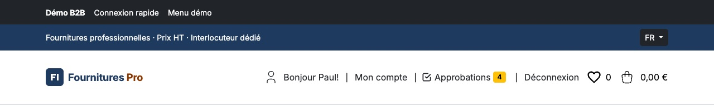
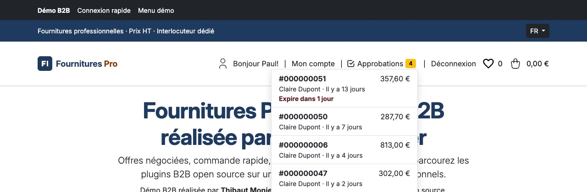
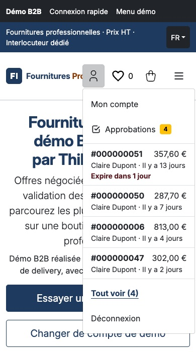
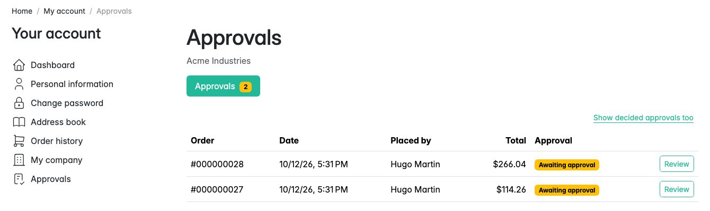
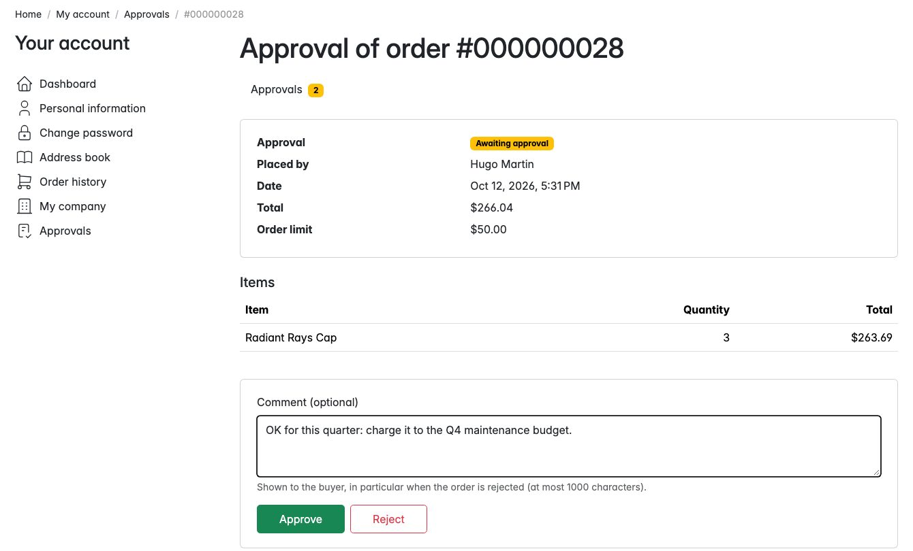
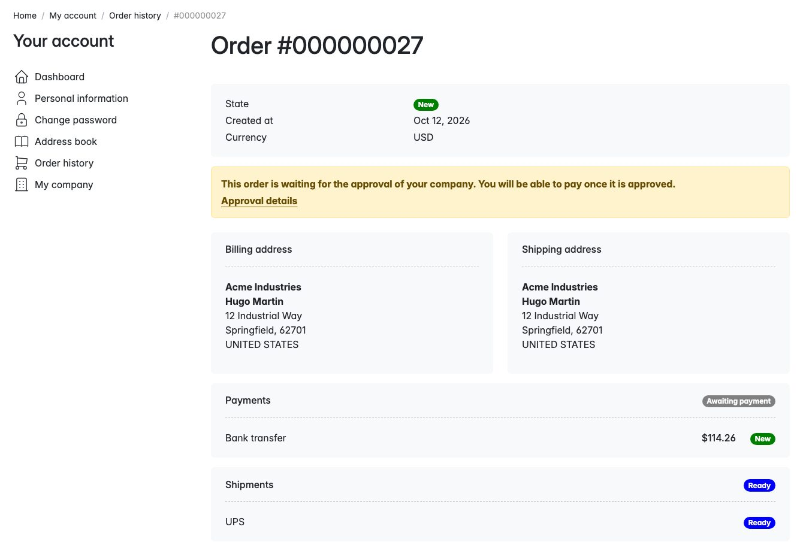
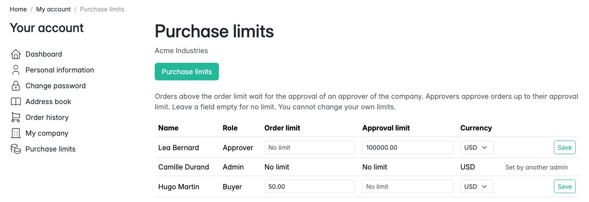
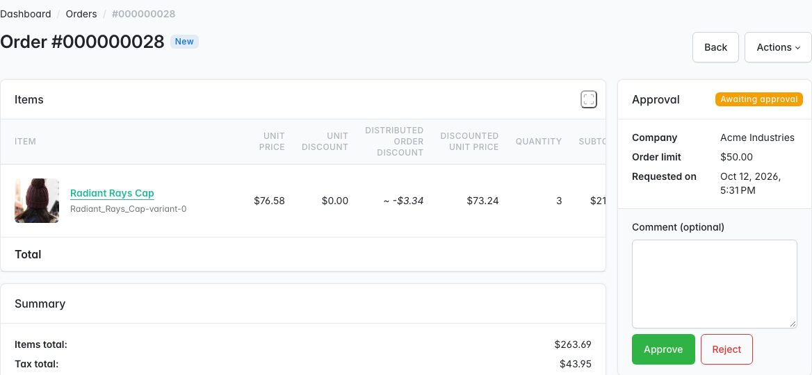
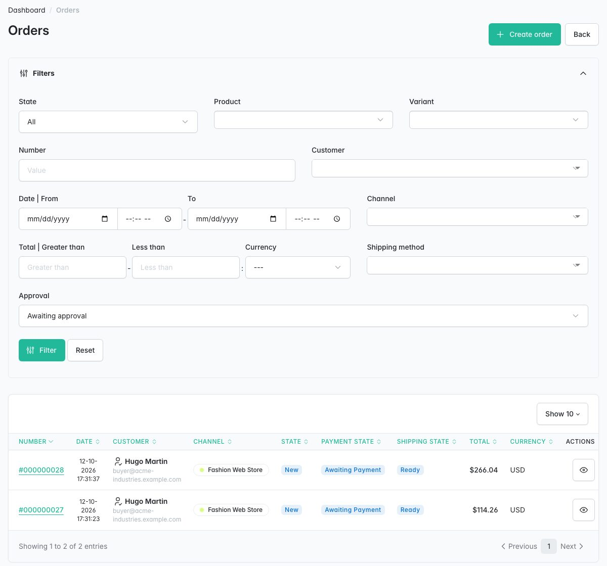

# Plugin Sylius Purchase Approval

> English: [README.md](README.md) <!-- vitrine:lang -->

[](https://github.com/thibmonier/sylius-purchase-approval-plugin/actions/workflows/build.yaml)
[](LICENSE)

**Validation des achats pour les comptes d'entreprise B2B de Sylius 2 : les commandes qui dépassent le plafond d'un acheteur attendent un
validateur de son entreprise avant de pouvoir être payées, expédiées ou facturées.**

Construit sur [tmonier/sylius-company-accounts-plugin](https://github.com/thibmonier/sylius-company-accounts-plugin)
(entreprises, membres, rôles) et sur le noyau de [tmonier/sylius-order-hold-plugin](https://github.com/thibmonier/sylius-order-hold-plugin)
(commandes maintenues impayées sans être annulées, points d'entrée de paiement bloqués). Sous licence MIT,
natif pour Sylius 2.2 / 2.3.

## Fonctionnalités

| Besoin | Ce que fait le plugin |
|---|---|
| Plafonner ce que chaque acheteur peut commander seul | **Plafond de commande** par membre de l'entreprise (montant et devise, table dédiée liée au membre). Une commande au-dessus de ce plafond, ou dans une autre devise que celle du plafond, attend une validation. Pas de plafond : pas de validation, la boutique fonctionne comme avant. |
| Laisser l'entreprise décider | Page **Approbations** dans le compte client pour les validateurs : d'abord les commandes de l'entreprise en attente, puis les décisions ; détail de la commande avec articles et totaux ; **validation ou refus avec un commentaire**. Une seule étape, **jamais sur sa propre commande**, dans la limite du **plafond de validation** du validateur. |
| Voir ce qui attend, sur toutes les pages | **Entrée « Approbations » dans l'en-tête de la boutique**, à côté de « Mon compte » (ordinateur et menu mobile), pour les membres qui peuvent valider : une pastille avec le nombre d'approbations en attente **qu'ils peuvent décider** (ni leurs propres commandes, ni celles au-delà de leur plafond de validation ; « 99+ » au-delà de 99), annoncé en texte aux lecteurs d'écran (« 3 approbations en attente », « Aucune approbation en attente »). Une seule requête `COUNT` par page, aucune pour un visiteur ou un acheteur. L'entrée mène à la liste filtrée sur ce que le membre décide (`?decidable=1`). `header_badge: false` la désactive. **Panneau d'aperçu** (1.3) : un clic sur l'entrée ouvre un panneau avec les 5 approbations à décider les plus anciennes (ce sont elles qui expirent en premier) : numéro de commande, acheteur, montant, ancienneté, et « Expire dans N jours » quand l'échéance est dans les 3 jours, puis « Tout voir (N) ». Il est chargé au premier clic (`GET /account/company/approvals-preview`, une requête), jamais avec la page, ne sert qu'à naviguer (la décision reste sur la page de la commande), se pilote au clavier (`aria-expanded`, Échap le ferme et rend le focus au bouton) et retombe sur le lien sans JavaScript. Le petit script est un fichier statique du bundle (`bundles/tmoniersyliuspurchaseapprovalplugin/header-approvals.js`, installé par `assets:install`, chargé avec `defer`) : il fonctionne avec une politique `script-src 'self'` stricte, sans nonce. |
| Laisser l'entreprise fixer ses règles | Page **Plafonds d'achat** pour les administrateurs de l'entreprise (un formulaire par collègue ; personne ne modifie ses propres plafonds). Les administrateurs de la boutique les définissent sur le formulaire du membre dans le back-office ou via l'API. |
| Aucun paiement, expédition ni facture avant la validation | La validation en attente est créée **dans le flush qui finalise le tunnel de commande**. Grâce au noyau order-hold, la page de paiement, les routes de capture Payum et les demandes de paiement de l'API boutique sont bloquées tant qu'elle n'est pas accordée (message flash / 422 ; les boutons Payer des pages de commande sont remplacés par l'avis de validation), et `sylius:cancel-unpaid-orders` laisse les commandes en attente tranquilles ; **une fois la validation accordée, le délai des commandes impayées court à partir de la date de validation**. Une garde bloque `sylius_shipment.ship`. Avec [sylius/invoicing-plugin](https://github.com/Sylius/InvoicingPlugin), la facture est générée à la validation, jamais pour une commande refusée (aucun avoir nécessaire). |
| Informer les personnes concernées | **Accusé de réception** à la place de la confirmation de commande tant que la commande attend, sur les deux chemins de confirmation (tunnel de commande de la boutique et API, y compris asynchrone) ; la **confirmation** habituelle **une fois la validation accordée**, envoyée une seule fois ; les validateurs de l'entreprise sont avertis d'une nouvelle demande ; l'acheteur est informé d'un refus ou d'une expiration, avec le commentaire. |
| Ne pas laisser des commandes en attente indéfiniment | `tmonier:approval:expire` fait expirer les validations en attente depuis plus de 14 jours (configurable) et annule leurs commandes ; elle clôt aussi les validations en attente des commandes annulées hors du workflow de commande (SQL brut, imports). Une commande refusée ou expirée est annulée avec la transition `sylius_order.cancel` du cœur (stock et utilisation des promotions libérés). Une commande annulée par la boutique (ou par l'API, ou un autre plugin) pendant son attente clôt sa validation (`cancelled`) : elle ne peut plus être validée. |
| Voir et agir dans le back-office | **Carte de validation sur la page de la commande** (état, entreprise, plafond, décision, commentaire) avec valider / refuser pour la boutique ; **colonne et filtre de validation dans la grille des commandes** (en attente, validée, refusée, expirée, annulée, aucune ; une requête par page pour la colonne). |
| Headless | API boutique `/api/v2/shop/company/approvals` (liste, élément, `approve`, `reject`) ; API d'administration `/api/v2/admin/order-approvals` et `/api/v2/admin/company-member-limits`. |
| Alimenter d'autres outils | Événements Symfony après chaque étape (`requested`, `approved`, `rejected`, `expired`) ; avec [tmonier/sylius-webhook-outbox-plugin](https://github.com/thibmonier/sylius-webhook-outbox-plugin), webhooks `order.approval_requested`, `order.approved` (l'événement métier « commande confirmée »), `order.approval_rejected`, `order.approval_expired`, écrits dans la transaction de la décision. |
| Commandes du personnel | Les commandes créées par le personnel avec [tmonier/sylius-admin-order-creation-plugin](https://github.com/thibmonier/sylius-admin-order-creation-plugin) pour un membre suivent les mêmes règles : au-dessus du plafond du membre, elles attendent elles aussi une validation, et son e-mail « lien de paiement » n'est pas proposé tant qu'elles ne sont pas validées. |

Également inclus : traductions en anglais, français, allemand, espagnol, italien, néerlandais et polonais
(pages, e-mails, messages) ; une fixture de démonstration ; prise en charge de MySQL, MariaDB et PostgreSQL (migration
via l'API Schema).

## Captures d'écran



















## Prérequis

| | Version |
|---|---|
| PHP | 8.2+ (Sylius 2.2), 8.3+ (Sylius 2.3) ; 8.5 testé avec Sylius 2.3 et Symfony 8 |
| Sylius | 2.2.9+, 2.3 |
| Symfony | 6.4, 7.4 (Sylius 2.2) ; 6.4, 7.4, 8.0 (Sylius 2.3, Symfony 8 nécessite PHP 8.4) |
| Requis | tmonier/sylius-company-accounts-plugin 1.1, tmonier/sylius-order-hold-plugin 1.0 |
| Facultatifs | sylius/invoicing-plugin 2.x, tmonier/sylius-webhook-outbox-plugin 1.0, tmonier/sylius-admin-order-creation-plugin 1.0 |

Les graphes `sylius_order_checkout`, `sylius_order`, `sylius_payment` et `sylius_shipment` doivent
utiliser l'adaptateur Symfony Workflow (par défaut dans Sylius 2).

## Installation

1. Installez le paquet :

    ```bash
    composer require tmonier/sylius-purchase-approval-plugin
    ```

2. Enregistrez les bundles dans `config/bundles.php` (les deux dépendances d'abord) :

    ```php
    Tmonier\SyliusOrderHoldPlugin\TmonierSyliusOrderHoldPlugin::class => ['all' => true],
    Tmonier\SyliusCompanyAccountsPlugin\TmonierSyliusCompanyAccountsPlugin::class => ['all' => true],
    Tmonier\SyliusPurchaseApprovalPlugin\TmonierSyliusPurchaseApprovalPlugin::class => ['all' => true],
    ```

3. Importez la configuration (ainsi que celle de company-accounts, voir son README) dans
   `config/packages/tmonier_sylius_purchase_approval.yaml` :

    ```yaml
    imports:
        - { resource: "@TmonierSyliusPurchaseApprovalPlugin/config/config.yaml" }
    ```

4. Importez les routes dans `config/routes/tmonier_sylius_purchase_approval.yaml` :

    ```yaml
    tmonier_sylius_purchase_approval:
        resource: "@TmonierSyliusPurchaseApprovalPlugin/config/routes.yaml"
    ```

    Les pages de la boutique se trouvent sous `/{_locale}/account/company/approvals` et
    `/{_locale}/account/company/limits`, derrière le contrôle d'accès du compte Sylius. Les opérations
    de l'API sont enregistrées auprès de l'API Sylius (`/api/v2`).

5. Exécutez les migrations (deux tables) :

    ```bash
    bin/console doctrine:migrations:migrate
    ```

6. Planifiez l'expiration, par exemple une fois par jour :

    ```bash
    bin/console tmonier:approval:expire
    ```

## Configuration

```yaml
# config/packages/tmonier_sylius_purchase_approval.yaml
tmonier_sylius_purchase_approval:
    # Member roles that approve the orders of their colleagues (within their approval limit).
    approver_roles: [approver]
    # Pending approvals older than this are expired by tmonier:approval:expire (orders cancelled).
    expire_after_days: 14
    # "Approvals" entry with the pending count in the shop header (members who can approve only).
    header_badge: true
```

Les modèles (`resources.order_approval`, `resources.member_limit`) peuvent être surchargés comme toute
ressource Sylius.

### Règles

| | |
|---|---|
| Qui a besoin d'une validation | Un membre actif d'une entreprise active, connecté (ou pris en charge par le personnel avec admin-order-creation), dont le total de commande dépasse son plafond de commande, ou dont le plafond est dans une autre devise que la commande. Les commandes invité n'en ont jamais besoin (company-accounts ne les traite jamais comme des commandes d'entreprise). |
| Qui valide | Les membres actifs de l'entreprise de la commande ayant un rôle dans `approver_roles`, jamais pour leur propre commande, et seulement jusqu'à leur plafond de validation (même devise que la commande ; vide : pas de maximum). Le refus n'est pas limité par le plafond de validation. |
| Qui définit les plafonds | Les administrateurs de l'entreprise dans la boutique (pas les leurs), les administrateurs de la boutique dans le back-office et l'API d'administration. |
| Administrateurs de la boutique | Valident ou refusent depuis la page de la commande ou l'API d'administration ; les règles de l'entreprise (plafonds, commandes personnelles) ne s'appliquent pas à eux. |
| Deux décisions en même temps | La ligne de validation est verrouillée puis relue : la seconde décision reçoit « This order is no longer waiting for an approval. » |

### E-mails

| Code | À | Quand |
|---|---|---|
| `tmonier_purchase_approval_acknowledgement` | acheteur | à la place de `order_confirmation` tant que la commande attend |
| `order_confirmation` (cœur) | acheteur | lorsque la commande est validée |
| `tmonier_purchase_approval_requested` | validateurs de l'entreprise (pas l'acheteur) | lorsque la commande est passée |
| `tmonier_purchase_approval_rejected` / `_expired` | acheteur | avec le commentaire de la décision |

Surchargez-les comme n'importe quel e-mail Sylius (`sylius_mailer.emails`).

Une confirmation par l'API (`SendOrderConfirmation`) consommée par un worker en retard après la décision est
abandonnée : l'acheteur reçoit la confirmation une seule fois (à la validation) et plus aucun accusé de réception.
Les confirmations envoyées volontairement (code, « Resend confirmation email » de l'administration) partent
toujours.

### Événements

Événements Symfony avec un `OrderApprovalEvent`, dispatchés après le flush :
`tmonier_purchase_approval.order_approval.requested`, `.approved`, `.rejected`, `.expired`
(une annulation par la boutique clôt la validation sans événement : les événements de commande du cœur s'appliquent).

### Webhooks

L'outbox émet toujours l'événement `order.placed` du cœur lorsque le tunnel de commande d'une commande en attente de
validation se termine : il signifie « reçue », pas « confirmée ». Une intégration qui expédie ou facture à partir des
commandes doit attendre `order.approved` lorsque `order.approval_requested` a été émis pour la même
commande (les deux portent la charge utile de la commande, plus un bloc `approval`), ou se fier à `order.placed` uniquement
pour les commandes sans validation.

## API

| Opération | Qui | Notes |
|---|---|---|
| `GET /api/v2/shop/company/approvals` | validateurs | `?state=pending` ; en attente d'abord ; prénom et nom de l'acheteur, jamais son e-mail |
| `GET /api/v2/shop/company/approvals/{orderNumber}` | validateurs, l'acheteur | `canApprove`, `canReject` pour le client connecté |
| `POST /api/v2/shop/company/approvals/{orderNumber}/approve` / `reject` | validateurs | `{"comment": "..."}` (facultatif, 1000 caractères) ; 422 en cas de refus (propre commande, plafond, déjà décidée) |
| `GET /api/v2/admin/order-approvals` (`?state=`), `GET .../{orderNumber}` | administrateurs | |
| `POST /api/v2/admin/order-approvals/{orderNumber}/approve` / `reject` | administrateurs | 422 si non en attente |
| `/api/v2/admin/company-member-limits` (`{id}`) | administrateurs | CRUD ; `member` IRI de `/api/v2/admin/company-members/{id}`, montants en plus petite unité monétaire |

Erreurs côté boutique : 401 sans jeton, 404 sans appartenance ou pour une validation hors de portée, 403 lorsque
la permission est refusée.

## Personnalisation

| Hook | Contenu |
|---|---|
| `tmonier_purchase_approval_shop.account.{approvals,approval,limits}.index.content.main` → `section` | Corps des pages |
| `sylius_shop.base.header.content.security.logged_in_user.desktop` et `….mobile.menu` → `tmonier_approvals` | Entrée « Approbations » avec le nombre en attente dans l'en-tête (priorité 50, entre « Mon compte » et « Se déconnecter ») |
| `tmonier_company_accounts.shop.account.company.tabs` → `tmonier_approvals`, `tmonier_purchase_limits` | Onglets Approbations et Plafonds d'achat de « Mon entreprise » (hook d'onglets de company-accounts 1.1) |
| `tmonier_purchase_approval_shop.account.{approvals,approval,limits}.index.content.main.header` → `navigation` | La barre d'onglets de company-accounts sur les pages de validation (`active_tab` : `approvals`, `limits`) |
| `sylius_shop.account.order.show.content.main.header` → `tmonier_approval` | Avis de validation sur la page de commande du client |
| `sylius_admin.order.show.content.sections#right` → `tmonier_approval` | Carte de validation de la page de commande de l'administration |

Services : `ApprovalPolicy` (règles), `ApprovalDecisionMaker` (décisions),
`ApprovalRequirementChecker`, le voter `tmonier_purchase_approval.voter.approval`
(`APPROVAL_LIST`, `APPROVAL_VIEW`, `APPROVAL_DECIDE`, `APPROVAL_LIMITS_MANAGE`).

## Limitations connues

- Une seule étape de validation, un seul validateur ; pas de validation à plusieurs niveaux, de budgets par période, de délégation ni
  de règles de validation par catégorie.
- Les passerelles qui encaissent l'argent pendant le tunnel de commande lui-même (avant la page de paiement) ne sont pas
  arrêtées : le paiement est finalisé, un avertissement est journalisé (canal `tmonier_purchase_approval`)
  et la commande attend tout de même sa validation avant l'expédition. Privilégiez les méthodes hors ligne ou à
  capture différée pour les entreprises ayant des plafonds.
- Les outils de facturation autres que sylius/invoicing-plugin ne sont pas reliés : s'ils facturent au
  moment du tunnel de commande, une commande refusée ensuite nécessite un avoir.
- Les plafonds sont des montants par commande, dans une seule devise par membre.
- Les administrateurs de l'entreprise ne voient pas les validations, ni l'entrée de l'en-tête, à moins que leur rôle ne figure dans `approver_roles` (`approver_roles: [approver, admin]` en fait des validateurs : ils décident comme n'importe quel validateur, jamais sur leurs propres commandes et dans la limite de leur propre plafond de validation).
- L'événement `requested` et les e-mails aux validateurs sont envoyés après le flush, et non après une
  transaction englobante ouverte par l'appelant : l'API du tunnel de commande (middleware Messenger `doctrine_transaction`)
  et admin-order-creation valident juste après ; si cette transaction englobante était annulée, les validateurs
  auraient été avertis d'une commande qui n'existe pas.

## Développement

```bash
cp compose.override.dist.yml compose.override.yml   # publishes MySQL and MailHog (or run `make init`)
docker compose up -d mysql mailhog
composer install
(cd vendor/sylius/test-application && yarn install && yarn build)
vendor/bin/console doctrine:database:create
vendor/bin/console doctrine:migrations:migrate -n
vendor/bin/console sylius:fixtures:load -n     # includes the demo company and approvals
```

Démo : `buyer@acme-industries.example.com` (plafond de commande 50.00, deux commandes en attente),
`approver@acme-industries.example.com` (*My account > Approvals*), `admin@...` (*Purchase
limits*), mot de passe `sylius`.

Les tests fonctionnels et d'intégration nécessitent une **base de données de test avec les fixtures Sylius** :

```bash
echo 'DATABASE_URL=mysql://root@127.0.0.1:3306/tmonier_sylius_purchase_approval_%kernel.environment%' > tests/TestApplication/.env.test.local
APP_ENV=test vendor/bin/console doctrine:database:create
APP_ENV=test vendor/bin/console doctrine:migrations:migrate -n
APP_ENV=test vendor/bin/console sylius:fixtures:load -n

vendor/bin/phpunit
vendor/bin/phpstan analyse
vendor/bin/ecs check
```

<!-- vitrine:demo-b2b:start -->
## Démo B2B

Ce plugin est utilisé dans la [démo B2B Sylius](https://github.com/thibmonier/sylius-b2b-demo) : une boutique Sylius 2.3 avec des données d'exemple fictives, où les plugins B2B fonctionnent ensemble. Le code source, l'installation et les fixtures de la démo sont dans ce dépôt.

- Démo en ligne : [sylius-b2b.thibaut-monier.fr](https://sylius-b2b.thibaut-monier.fr)
- Auteur : [Thibaut Monier](https://www.linkedin.com/in/thibautmonier/)

La démo est un exemple, pas une configuration de production.
<!-- vitrine:demo-b2b:end -->

## Licence

MIT. Voir [LICENSE](LICENSE).
